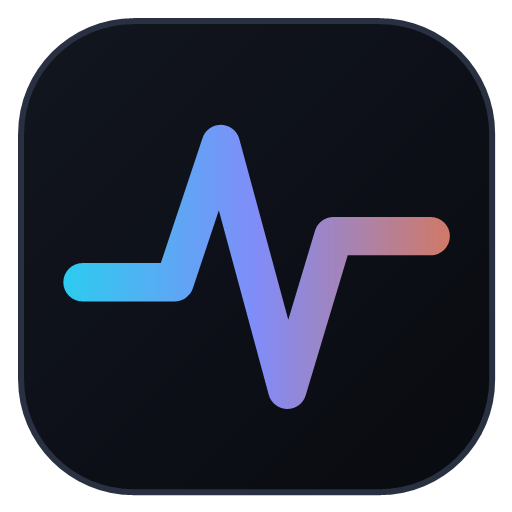
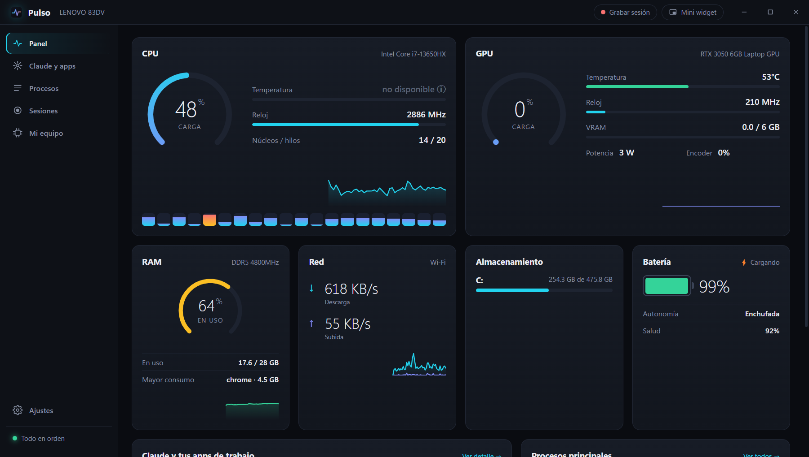
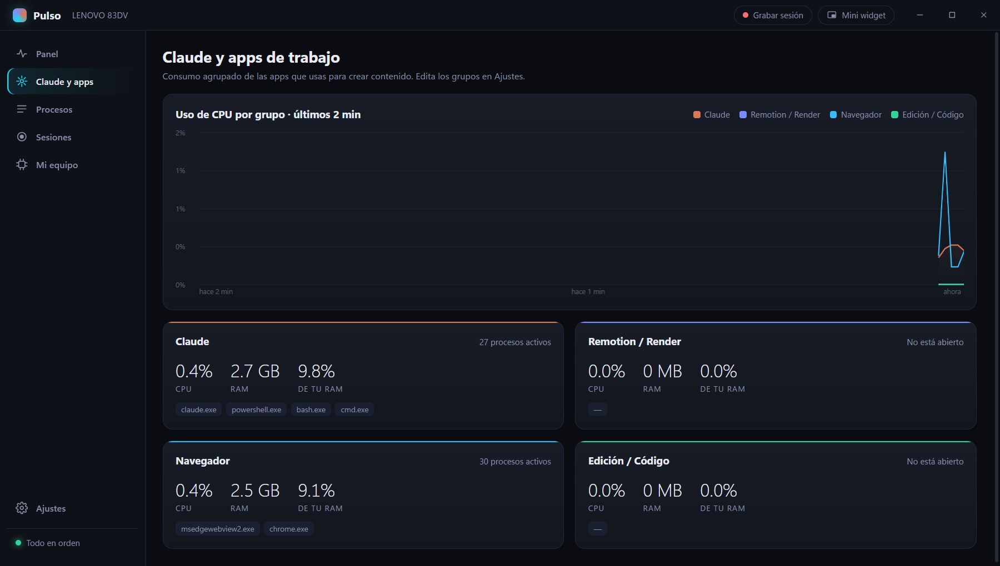

<p align="center">
  
</p>

<h1 align="center">Pulso</h1>

<p align="center">
  <b>Monitor de hardware gratuito y de código abierto para creadores de contenido.</b><br>
  CPU, GPU, RAM, red, disco y batería en vivo, y además <b>cuánto consumen tus apps de trabajo</b>: Claude, el navegador, el editor y el render.
</p>

<p align="center">
  <a href="../../releases/latest"><b>⬇ Descargar</b></a> ·
  <a href="#funciones">Funciones</a> ·
  <a href="#compatibilidad">Compatibilidad</a> ·
  <a href="#english">English</a>
</p>



## ¿Por qué Pulso?

Los monitores de hardware te dicen *cuánto* trabaja tu equipo. Pulso además te dice **quién lo está haciendo trabajar** mientras creas: agrupa los procesos de Claude, el navegador, el editor y el render, y te deja **grabar una sesión** (por ejemplo, mientras editas o exportas un video) para ver el promedio y el pico de cada recurso.

- **100 % local:** no envía ningún dato a internet. Sin cuentas, sin anuncios ni telemetría.
- **Gratis y open source** (licencia MIT).
- **Ligero:** lee los sensores cada segundo y casi no consume.



## Funciones

| | |
|---|---|
| **Panel en vivo** | CPU (carga, reloj real con turbo, carga por hilo), GPU (carga, temperatura, reloj, VRAM, potencia, encoder), RAM, red, discos y batería (autonomía y salud). |
| **Historial** | Gráficas de los últimos 2 minutos en cada tarjeta. |
| **Claude y apps** | Consumo agrupado por apps: Claude, Render/Exportar, Navegador, Edición/Código. Los grupos se pueden editar. |
| **Sesiones de grabación** | Pulsa *Grabar sesión*, trabaja y detén: obtienes un resumen (promedio y pico) con gráfica, que se guarda también en CSV. |
| **Mini widget** | Una ventana pequeña, siempre visible encima de las demás, con CPU, GPU, RAM, Claude y temperaturas. |
| **Alertas** | Notificaciones del sistema si la CPU o la GPU se calientan, o si la RAM se llena. |
| **Procesos** | Tabla agrupada por programa, con búsqueda y orden por columnas. |

## Compatibilidad

| Dato | Windows | macOS (Apple Silicon / Intel) | Linux |
|---|---|---|---|
| CPU, RAM, red, disco, batería | ✅ | ✅ | ✅ |
| GPU NVIDIA (completa) | ✅ | — | ✅ |
| GPU AMD / Intel | ✅ carga | — | ✅ AMD: carga, VRAM y temperatura |
| GPU Apple (M1/M2/M3…) | — | ✅ carga y memoria en uso | — |
| Temperatura CPU | ⚠️ con [LibreHardwareMonitor](https://github.com/LibreHardwareMonitor/LibreHardwareMonitor) abierto | ⚠️ depende del modelo | ✅ con `lm-sensors` |
| Ventiladores | ⚠️ con LibreHardwareMonitor | — | — |

> La versión de Windows está probada a diario. Las de macOS y Linux se compilan automáticamente y todavía están en fase **beta**: si algo falla, [abre un issue](../../issues).

## Instalación

Descarga el archivo para tu sistema desde **[Releases](../../releases/latest)**:

- **Windows:** `Pulso-Setup-x.y.z.exe` (instalador) o `Pulso-Portable-x.y.z.exe` (sin instalar).
  La primera vez, Windows SmartScreen puede avisar porque la app no tiene firma digital: pulsa *Más información → Ejecutar de todas formas*.
- **macOS:** `Pulso-x.y.z-mac-arm64.dmg` (M1/M2/M3) o `-x64.dmg` (Intel). Arrastra Pulso a Aplicaciones.
  Como la app no está firmada por Apple, la primera vez ejecuta esto en Terminal:
  ```bash
  xattr -cr /Applications/Pulso.app
  ```
- **Linux:** `Pulso-x.y.z-linux-x86_64.AppImage` (dale permisos de ejecución) o el `.deb`.

### Ver la temperatura de la CPU en Windows

Windows no deja leer este sensor sin permisos de administrador. Descarga [LibreHardwareMonitor](https://github.com/LibreHardwareMonitor/LibreHardwareMonitor/releases) (gratis) y ábrelo **como administrador**; puede quedarse minimizado. Pulso detecta solo la temperatura y los ventiladores.

## Desarrollo

Requisitos: [Node.js](https://nodejs.org) 20 o superior.

```bash
git clone https://github.com/AGENTE-JR/pulso.git
cd pulso
npm install
npm start
```

| Comando | Qué hace |
|---|---|
| `npm start` | Abre la app en modo desarrollo |
| `npm run dist` | Genera el instalador y el portable de Windows en `dist/` |
| `npm run dist:mac` / `dist:linux` | Igual para macOS (requiere una Mac) o Linux |
| `npm run icon` | Regenera el icono (Windows) |

**Publicar una versión:** sube el número en `package.json` y crea una etiqueta (`git tag v1.1.0 && git push origin v1.1.0`). GitHub Actions compila para los tres sistemas y deja un borrador de Release listo para publicar.

### Estructura

```
main.js        Proceso principal: lee sensores y los envía a la interfaz
preload.js     Puente seguro entre el proceso principal y la interfaz
src/           Interfaz (HTML/CSS/JS sin frameworks) y mini widget
build/         Icono y script que lo genera
.github/       Compilación automática para Windows, macOS y Linux
```

## Contribuir

¡Las contribuciones son bienvenidas! Ideas en las que puedes ayudar:

- Probar y mejorar el soporte de macOS y Linux.
- Leer la temperatura de la CPU sin programas externos.
- Mostrar Pulso en la bandeja del sistema, abrirlo al iniciar el equipo y añadir un tema claro.
- Traducciones.

Abre un *issue* para comentar la idea o manda directamente un *pull request*.

## Apoya el proyecto

Si Pulso te resulta útil, dale una ⭐ al repo y compártelo. Eso ayuda a que más gente lo encuentre.

---

<a id="english"></a>
## English

**Pulso** is a free, open-source hardware monitor for content creators. It shows live CPU, GPU, RAM, network, disk and battery stats, groups resource usage by work apps (Claude, browser, editor, render), and lets you **record sessions** to see the average and peak usage while you edit or export a video. It runs 100 % locally and sends no data anywhere. It works on Windows (stable), with macOS and Linux in beta. Download it from [Releases](../../releases/latest). License: MIT.
